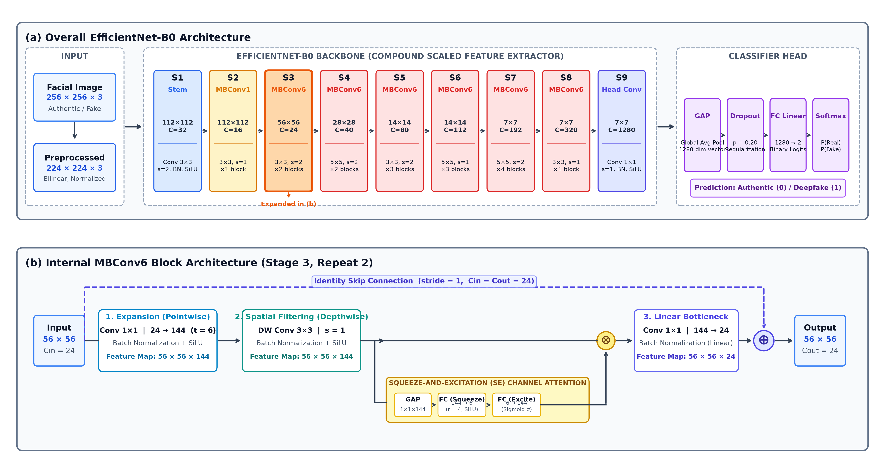
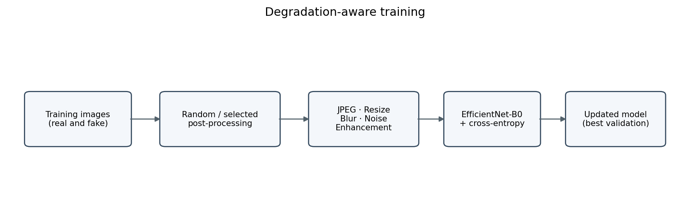
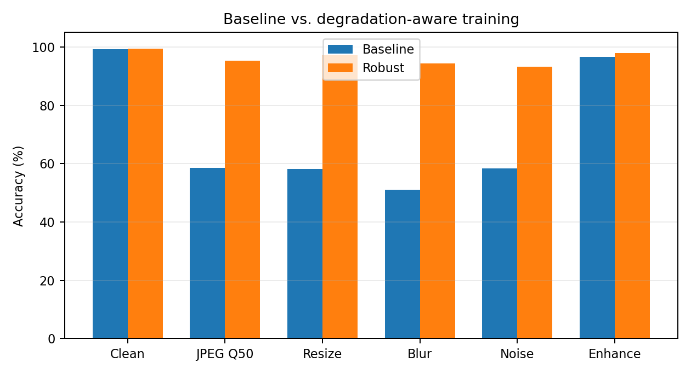
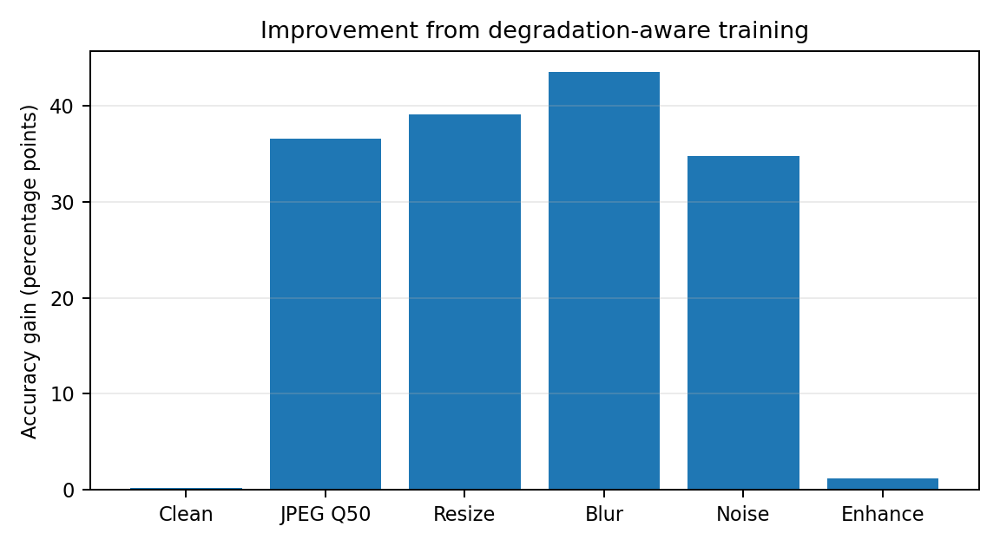

# Robust Deepfake Image Detection Under Real-World Post-Processing Using EfficientNet-B0

[](https://www.python.org/)
[](https://pytorch.org/)
[](LICENSE)
[](https://arxiv.org/abs/1905.11946)

Official repository for the deep learning research project:
> **"Robust Deepfake Image Detection Under Real-World Post-Processing Using EfficientNet-B0"**  
> *Hemanth Bolla, Poola Gowtham, Chilukuri Venkata Uday Adhitya, Devarakonda Yaswanth*  
> School of Computer Science and Engineering (SCOPE), VIT-AP University, Amaravati, India

---

## 1. Project Title & Research Objective

**Title:** Robust Deepfake Image Detection Under Real-World Post-Processing Using EfficientNet-B0

**Objective:**  
To systematically evaluate the forensic vulnerability of convolutional deepfake detectors when deployed outside controlled laboratory benchmarks, and to develop an effective, lightweight degradation-aware fine-tuning methodology that restores post-processing resilience without modifying network architecture or increasing inference latency.

---

## 2. Research Problem & Motivation

State-of-the-art generative models (e.g., NVIDIA StyleGAN) synthesize photorealistic facial images that exhibit minute frequency-domain anomalies and subtle pixel-level boundary artifacts. While conventional Convolutional Neural Networks (CNNs) achieve near-perfect classification on pristine benchmarks (>99% accuracy), they heavily overfit to these fragile, high-frequency cues.

When images are transmitted through real-world social-media channels, messaging applications, or web pipelines, ubiquitous operations such as **JPEG compression**, **spatial resizing**, **Gaussian blur**, **sensor noise**, and **enhancement** attenuate or destroy these fragile forensic artifacts:

```text
  Clean Test Images            =======================>  99.25% Accuracy (Baseline)
  Post-Processed (Blur r=2.0)  =======================>  50.97% Accuracy (Catastrophic Collapse: -48.28 pp)
  Post-Processed (Resize 112)  =======================>  58.14% Accuracy (Collapse: -41.11 pp)
  Post-Processed (JPEG Q=50)   =======================>  58.63% Accuracy (Collapse: -40.62 pp)
  Post-Processed (Noise 0.05)  =======================>  58.45% Accuracy (Collapse: -40.80 pp)
```

This vulnerability demonstrates that benchmark performance on clean data does not translate to reliability in open-world forensic deployments.

---

## 3. Dataset Description & Access Instructions

Experiments are conducted using the benchmark **140k Real and Fake Faces** dataset:
- **Source:** Kaggle ([xhlulu/140k-real-and-fake-faces](https://www.kaggle.com/datasets/xhlulu/140k-real-and-fake-faces))
- **Composition:** 140,000 balanced $256 \times 256$ RGB images
  - **70,000 Authentic Faces:** Flickr-Faces-HQ (FFHQ) high-quality human photography
  - **70,000 Synthesized Faces:** NVIDIA StyleGAN generative facial synthesis
- **Label Mapping:** `Class 0 = FAKE` (synthetic deepfakes), `Class 1 = REAL` (authentic human photography)

### Experimental Partitions (Reproducible with Seed 42):
- **Training Subset:** 20,000 images (10,000 fake, 10,000 real)
- **Validation Subset:** 4,000 images (2,000 fake, 2,000 real)
- **Independent Test Set:** 20,000 images (10,000 fake, 10,000 real)

*(See [`data/README.md`](data/README.md) for automated download and directory formatting instructions).*

---

## 4. EfficientNet-B0 Architectural Framework

The detector employs **EfficientNet-B0** (~5.3M parameters) as a controlled, reproducible CNN backbone utilizing compound scaling across network depth, width, and input resolution ($224 \times 224$):



### Key Architectural Specifications:
- **Preprocessing:** Bilinear resize to $224 \times 224 \times 3$ and channel-wise normalization using ImageNet priors ($\boldsymbol{\mu} = [0.485, 0.456, 0.406]$, $\boldsymbol{\sigma} = [0.229, 0.224, 0.225]$).
- **Backbone (Stages S1–S9):** Initial $3 \times 3$ convolutional stem, 16 Mobile Inverted Bottleneck Convolution (MBConv) blocks with depthwise separable convolutions, Squeeze-and-Excitation (SE) channel attention ($r = 4$), SiLU activations, and a final $1 \times 1$ pointwise convolution producing a $7 \times 7 \times 1280$ representation.
- **Classification Head:** Global Average Pooling (GAP $\to 1280$), Dropout ($p = 0.20$), and a fully connected linear layer ($1280 \to 2$) outputting raw unnormalized logits $\mathbf{z} \in \mathbb{R}^2$.
- **Inference Probabilities:** Softmax is evaluated post-hoc during inference/evaluation to obtain posterior class probabilities $P(\text{Fake})$ and $P(\text{Real})$.

---

## 5. Baseline Training Procedure

The baseline model establishes the pristine-benchmark reference:
- **Initialization:** Pretrained ImageNet-1k backbone weights.
- **Data:** Clean training subset (20,000 images) with standard horizontal flipping.
- **Optimization:** Adam optimizer ($\eta = 10^{-4}$), mini-batch size $N = 32$, 5 epochs.
- **Loss:** PyTorch `nn.CrossEntropyLoss` directly receiving raw unnormalized logits.
- **Peak Validation:** Checkpoint saved at Epoch 5 achieving **99.35% validation accuracy** (validation loss 0.0203).

---

## 6. Degradation-Aware Robust Fine-Tuning

The robust model builds post-processing resilience through dynamic data perturbation:
- **Initialization:** Loaded directly from the saved baseline checkpoint (Epoch 5).
- **Optimization:** Adam optimizer with reduced learning rate ($\eta = 5 \times 10^{-5}$), batch size 32, 5 fine-tuning epochs (totaling 10 cumulative optimization epochs).
- **Stochastic Augmentation Workflow ($p = 0.70$):**
  - **JPEG Compression:** Quality factor $Q \in \{30, 40, 50, 60\}$.
  - **Spatial Resizing:** Downscaling to $\{96, 112, 128\}$ with bilinear restoration to $224 \times 224$.
  - **Gaussian Blur:** Isotropic kernel radius $r \in \{0.5, 1.0, 1.5, 2.0\}$.
  - **Additive Gaussian Noise:** Zero-mean noise with $\sigma_{\text{noise}} \in [0.02, 0.08]$.
  - **Enhancement:** Contrast expansion ($\alpha \in [1.1, 1.5]$) and sharpness boosting ($\beta \in [1.2, 2.0]$).
- **Validation Protocol:** Validation split remains strictly pristine, reaching **99.53% validation accuracy** at Epoch 5.



---

## 7. Evaluation Methodology & Reported Results

Both models are rigorously evaluated on the **independent 20,000-image test set** across six controlled conditions:

### A. Stress-Testing Benchmark Comparison (Paper Table IX)

| Test Condition | Stress Parameters | Baseline Model | Robust Model | Absolute Gain (pp) | Relative Error Reduction (RER) |
|:---|:---|:---:|:---:|:---:|:---:|
| **Clean Baseline** | Pristine images | **99.25%** | **99.42%** | **+0.17** | Pristine Preservation |
| **JPEG Compression** | $Q = 50$ (8x8 DCT) | 58.63% | **95.25%** | **+36.62** | **88.52%** |
| **Spatial Resizing** | $256 \to 112 \to 256$ | 58.14% | **97.20%** | **+39.06** | **93.31%** |
| **Gaussian Blur** | Radius $r = 2.0$ | 50.97% | **94.46%** | **+43.49** | **88.70%** |
| **Gaussian Noise** | Additive $\sigma = 0.05$ | 58.45% | **93.22%** | **+34.77** | **83.68%** |
| **Enhancement** | Contrast $\alpha=1.5$, Sharpness $\beta=2.0$ | 96.66% | **97.85%** | **+1.19** | **35.63%** |




### B. Baseline Confusion Matrix (Clean Test Set, Paper Table IV)
Defined with authentic facial photographs as the positive class ($y=1$):

```text
                     Predicted FAKE (0)    Predicted REAL (1)
  Actual FAKE (0)         9,961 (TN)              39 (FP)
  Actual REAL (1)           111 (FN)           9,889 (TP)
```
- **Accuracy:** 99.25% (19,850 / 20,000 correct)
- **Real Precision / Recall:** 99.61% / 98.89%
- **Fake Precision / Recall:** 98.90% / 99.61%

---

## 8. Installation & Execution Instructions

### Step 1: Environment Setup
```bash
# Clone repository (Verified Public Repository)
git clone https://github.com/gowthampoola/robust-deepfake-detection-efficientnet-b0.git
cd robust-deepfake-detection-efficientnet-b0

# Alternative Mirror:
# git clone https://github.com/bolla-hemanth/robust-deepfake-detection-efficientnet-b0.git
```

# Create and activate virtual environment
python -m venv .venv
# On Windows:
.venv\Scripts\activate
# On Linux/macOS:
# source .venv/bin/activate

# Install dependencies
pip install --upgrade pip
pip install -r requirements.txt
```

### Step 2: Diagnostic System Verification
```bash
python training/test_setup.py
```

### Step 3: Model Training
```bash
# 1. Train clean baseline model (5 epochs)
python training/train_baseline.py --epochs 5 --batch-size 32 --lr 1e-4

# 2. Fine-tune robust model with on-the-fly perturbations (5 epochs)
python training/train_robust.py --epochs 5 --batch-size 32 --lr 5e-5 --aug-prob 0.70
```
*(Execution scripts can also be invoked interchangeably from `src/train_baseline.py` and `src/train_robust.py`).*

### Step 4: Model Evaluation & Benchmarking
```bash
# 1. Evaluate clean test set accuracy and confusion matrix
python evaluation/evaluate_test.py --model-path models/efficientnet_b0_baseline_best.pth

# 2. Stress-test across all 6 post-processing conditions
python evaluation/evaluate_robustness.py --model-path models/efficientnet_b0_robust_best.pth

# 3. Reproduce paper comparative benchmark table
python evaluation/compare_models.py
```

### Step 5: Interactive Visual Demonstration
```bash
# Compare baseline vs robust predictions under Gaussian blur (choice 4)
python evaluation/demo_compare_postprocessing.py --image path/to/sample_face.jpg --choice 4

# Run single-image inference
python src/predict.py --image path/to/sample_face.jpg --model robust
```

---

## 9. Repository Structure

```text
Deepfake_Detection_GitHub_Repository/
├── assets/                             # Publication-quality figures & diagrams
│   ├── efficientnet_b0_architecture.drawio # Editable Draw.io architecture source
│   ├── efficientnet_b0_architecture.png    # High-resolution block diagram
│   ├── overall_research_pipeline.png       # End-to-end research methodology workflow
│   ├── robust_training_pipeline.png        # Stochastic augmentation diagram
│   ├── baseline_training_curves.png        # Baseline accuracy trajectory
│   ├── baseline_robustness.png             # Baseline post-processing collapse chart
│   ├── robust_training_curves.png          # Robust fine-tuning accuracy trajectory
│   ├── baseline_vs_robust_accuracy.png     # Side-by-side performance comparison
│   └── robustness_improvement.png          # Absolute accuracy recovery chart
├── configs/                            # Centralized hyperparameter configurations
│   ├── __init__.py
│   ├── config.py                       # Programmatic configuration module
│   └── config.yaml                     # YAML configuration file
├── data/                               # Dataset documentation & placeholder
│   ├── README.md                       # Kaggle download & organization guide
│   └── .gitkeep
├── docs/                               # Final authoritative publication paper
│   ├── README.md                       # Documentation guide & citation info
│   └── Deepfake_Detection_Final_Paper.pdf  # Authoritative 11-page IEEE final paper
├── evaluation/                         # Benchmarking & demonstration scripts
│   ├── __init__.py
│   ├── evaluate_test.py                # Clean test set evaluation & confusion matrix
│   ├── evaluate_robustness.py          # 6-condition post-processing stress testing
│   ├── compare_models.py               # Side-by-side benchmark table generator
│   └── demo_compare_postprocessing.py  # Interactive visual before/after demo
├── models/                             # Model checkpoints placeholder & guide
│   ├── README.md                       # Checkpoint documentation & reproduction guide
│   └── .gitkeep
├── notebooks/                          # Interactive Jupyter experimentation
│   ├── README.md
│   └── deepfake_detection_walkthrough.ipynb # Complete step-by-step walkthrough
├── results/                            # Sample visual demonstration artifacts
│   ├── README.md
│   ├── .gitkeep
│   └── demo_processed_gaussian_blur_r2.jpg # Sample processed test artifact
├── src/                                # Core model architecture & utilities
│   ├── __init__.py
│   ├── model.py                        # EfficientNet-B0 network builder
│   ├── dataset.py                      # Dataset loader & augmentation classes
│   ├── utils.py                        # Common utility routines & transforms
│   ├── test_setup.py                   # Environment test utility
│   ├── train_baseline.py               # Baseline training entry point
│   ├── train_robust.py                 # Robust training entry point
│   ├── predict.py                      # Unified CLI prediction tool
│   ├── predict_baseline.py             # Single-image baseline inference
│   └── predict_robust.py               # Single-image robust inference
├── training/                           # Dedicated training pipelines
│   ├── __init__.py
│   ├── README.md                       # Training instructions & parameters
│   ├── test_setup.py                   # Environment verification script
│   ├── train_baseline.py               # Standalone baseline training pipeline
│   └── train_robust.py                 # Standalone robust fine-tuning pipeline
├── .gitignore                          # Clean exclusions (datasets, caches, weights)
├── LICENSE                             # MIT Open-Source License
├── requirements.txt                    # Project Python dependencies
└── README.md                           # Master repository documentation (this file)
```

---

## 10. Research Paper & Repository Locations

The authoritative publication paper is located at:
- **Path:** [`docs/Deepfake_Detection_Final_Paper.pdf`](docs/Deepfake_Detection_Final_Paper.pdf)
- **Format:** IEEE Conference format, complete with mathematical formulations, full architectural block diagrams, experimental benchmarks, error analysis, and 45 verified citations.

### Public Repository Links:
- **Primary Verified Repository:** [https://github.com/gowthampoola/robust-deepfake-detection-efficientnet-b0](https://github.com/gowthampoola/robust-deepfake-detection-efficientnet-b0)
- **Author Mirror Repository:** [https://github.com/bolla-hemanth/robust-deepfake-detection-efficientnet-b0](https://github.com/bolla-hemanth/robust-deepfake-detection-efficientnet-b0)

---

## 11. Citation & Academic Reference

```bibtex
@inproceedings{bolla2026robust,
  author    = {Hemanth Bolla and Poola Gowtham and Chilukuri Venkata Uday Adhitya and Devarakonda Yaswanth},
  title     = {Robust Deepfake Image Detection Under Real-World Post-Processing Using EfficientNet-B0},
  booktitle = {Proceedings of the IEEE Conference on Computer Vision and Deep Learning Forensics},
  year      = {2026}
}
```

---

## 12. License

This project is licensed under the [MIT License](LICENSE).
